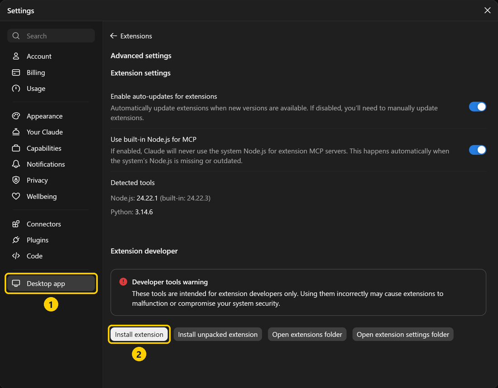
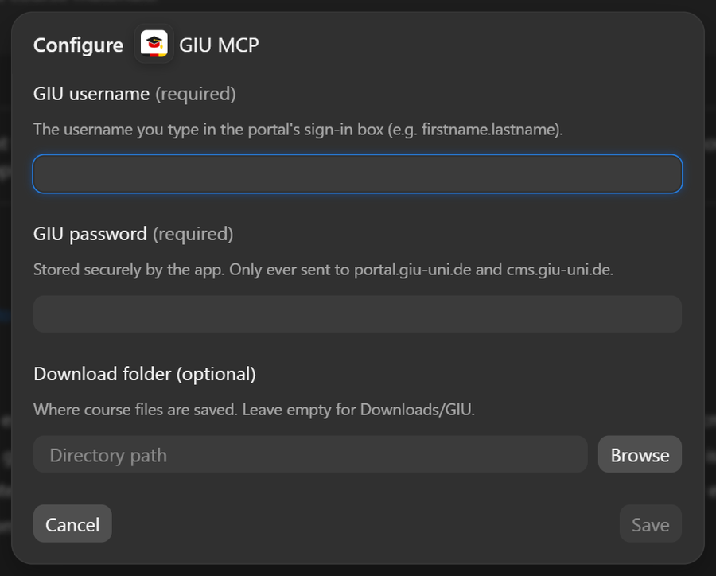

<h1 align="center">
  <picture>
    <source media="(prefers-color-scheme: dark)" srcset="https://raw.githubusercontent.com/Youssef-Hany-codes/GIU-MCP/main/assets/png/giu-mcp-horizontal-dark.png">
    
  </picture>
</h1>

Let your AI assistant read **your own** GIU student portal (`portal.giu-uni.de`) and CMS
(`cms.giu-uni.de`). Ask things like *"what's my schedule tomorrow?"*, *"how am I doing in
Databases?"*, *"summarise this week's lecture slides"* or *"download all OS lab manuals"*.

It works with any AI app that supports local MCP servers: Claude Code, Claude Desktop,
Cursor, VS Code (Copilot agent mode), Windsurf, Gemini CLI, OpenAI Codex CLI, LM Studio
and others.

<p align="center">
  <a href="https://github.com/Youssef-Hany-codes/GIU-MCP/releases/latest/download/giu-mcp.mcpb">
    
  </a>
  <br>
  <sub>Other AI apps: <code>uvx giu-mcp login</code> · <a href="#any-other-ai-app-claude-code-cursor-vs-code-">setup guide</a></sub>
  <br><br>
  <a href="https://pypi.org/project/giu-mcp/"></a>
  <a href="https://github.com/Youssef-Hany-codes/GIU-MCP/releases/latest"></a>
</p>

> **Unofficial.** This is a student project, not made or endorsed by GIU. It reads the
> same pages you see in your browser, signed in as you.
>
> **Free for personal and non-commercial use.** If you share it or build on it, keep the
> credit line. Commercial use needs permission first. See [License](#license).

## Your account and your data stay with you

- Every student runs their **own copy** on their own computer with their **own** GIU
  username and password. Nobody else, including whoever shared this with you, ever sees
  your password or your data.
- Your password is kept in secure storage, never a plain file: the Claude Desktop
  extension uses the app's secure storage, and `giu-mcp login` uses your operating
  system's credential store (Windows Credential Manager / macOS Keychain / Linux Secret
  Service).
- Your password is only ever sent to `portal.giu-uni.de` and `cms.giu-uni.de`. Every
  redirect is checked first, so it is never sent anywhere else.
- **Read-only.** It never submits anything: no registration, evaluations, excuses,
  uploads or payments. The only thing it writes is files you ask it to download, saved
  to your own Downloads folder.

## Install

### Claude Desktop: no terminal

1. **[Download giu-mcp.mcpb](https://github.com/Youssef-Hany-codes/GIU-MCP/releases/latest/download/giu-mcp.mcpb)**
   (always the newest version).
2. In Claude Desktop, open **Settings → Desktop app → Extensions → Advanced settings**,
   click **Install extension**, and pick the file you downloaded.

   

   Double-clicking the file only works on some installs. On Windows, the Microsoft
   Store version of Claude doesn't register `.mcpb` files, so Windows will say it has
   no app to open it.
3. Fill in your **GIU username and password**, the same ones you use on the portal, then
   click **Save** and enable the extension.

   

That's it: you don't need to install Python or anything else first. The very first start
takes a few seconds while Claude Desktop sets it up. To change your password later, go to
**Settings → Desktop app → Extensions → GIU MCP → Configure**.

### Any other AI app (Claude Code, Cursor, VS Code, …)

You need [uv](https://docs.astral.sh/uv/). It also installs Python for you, so nothing
else is required. Install it once:

```powershell
# Windows (macOS/Linux: curl -LsSf https://astral.sh/uv/install.sh | sh)
powershell -ExecutionPolicy ByPass -c "irm https://astral.sh/uv/install.ps1 | iex"
```

Then, in a new terminal (about 2 minutes):

```powershell
uvx giu-mcp login     # asks for your GIU username + password, checks them, saves them securely
uvx giu-mcp status    # optional: confirms the portal and CMS both work
uvx giu-mcp config    # prints the exact snippet for your AI app
```

`uvx` downloads `giu-mcp` from [PyPI](https://pypi.org/project/giu-mcp/) and runs it; there
is no separate install step. Use the same username and password as the browser sign-in
box on the portal. To get a newer version later, run `uvx --refresh giu-mcp --version`
and restart your AI app.

> Prefer a permanent install? `uv tool install giu-mcp` (or `pipx install giu-mcp`), then
> use `giu-mcp login` / `giu-mcp config` without the `uvx`.

Then add the server to your app with the snippet `config` printed:

- **Claude Code:** run the printed `claude mcp add giu …` command once.
- **Claude Desktop:** Settings → Developer → Edit Config, paste the `"giu"` entry inside
  `"mcpServers"`, then restart Claude Desktop.
- **Cursor / Windsurf / Gemini CLI / most others:** the same `"mcpServers"` JSON in that
  app's MCP config file.
- **VS Code:** `uvx giu-mcp config vscode`. **Codex CLI:** `uvx giu-mcp config codex`.

Restart the app, and the GIU tools will show up. To switch accounts, run
`uvx giu-mcp login` again. To remove yours, run `uvx giu-mcp logout`.

## What it can do

| Tool | What it returns |
| --- | --- |
| `giu_profile` | Name, student ID, username, faculty, major |
| `portal_schedule` | Your weekly timetable (day → period → course, room, group, type) |
| `portal_group_schedule` | Timetable of any study group (empty = list groups) |
| `portal_grades` | This semester's midterm % per course + every quiz/assignment score |
| `portal_previous_grades` | The same for a past season (empty = list seasons) |
| `portal_transcript` | Final grades, hours and cumulative GPA, by semester |
| `portal_attendance` | Absence warning levels, attended/absent counts, every session |
| `portal_exam_seats` | Exam date, time, hall and seat |
| `cms_courses` | Your CMS courses (current or all seasons) |
| `cms_course_content` | Course announcement + weekly items (slides, assignments, videos) |
| `cms_whats_new` | Unopened content per course and the latest posts |
| `cms_notifications` | Recent CMS notifications |
| `cms_read_file` | Text of a course PDF / PPTX / DOCX so the AI can summarise or quiz you |
| `cms_download` | Save course files to `~/Downloads/GIU/<course>/<week>/` |

Courses can be named loosely: `"INCS101"`, `"databases"`, `"German"`.

### Ready-made prompts

In apps that support MCP prompts, these show up as commands you can pick from a menu.
In Claude Desktop they're in the **+** menu; in Claude Code, type `/mcp__giu__` and pick
one.

| Prompt | What it does |
| --- | --- |
| `weekly_briefing` | Classes, deadlines, new CMS content, grades, absence warnings and exams in one summary |
| `whats_due` | Every upcoming deadline, quiz and exam across your courses, as a dated table |
| `quiz_me` | Quizzes you one question at a time on a lecture or topic (`course`, optional `topic`) |
| `summarize_lecture` | Main ideas, definitions, an example and self-check questions (`course`, optional `lecture`) |
| `exam_prep` | A day-by-day study plan for a course's exam (`course`, optional `exam_date`) |

In apps without prompt menus, just ask in your own words, e.g. *"quiz me on the latest
Databases lecture"*.

## Settings

All optional. Set them as environment variables, or in a `.env` file in the config
folder (`uvx giu-mcp status` shows where that is).

| Variable | Meaning |
| --- | --- |
| `GIU_USERNAME`, `GIU_PASSWORD` | Use these instead of the account saved by `giu-mcp login` |
| `GIU_DOMAIN` | Windows domain, only if sign-in fails without it |
| `GIU_DOWNLOAD_DIR` | Where `cms_download` saves files (default `~/Downloads/GIU`) |
| `GIU_TIMEOUT` | Request timeout in seconds (default 45) |

## Troubleshooting

- **"No GIU account is set up"**: run `uvx giu-mcp login` in a terminal. With the
  Claude Desktop extension, fill in Settings → Desktop app → Extensions → GIU MCP → Configure instead.
- **"GIU rejected the username/password"**: your password probably changed. Update it
  in Settings → Desktop app → Extensions → GIU MCP → Configure (extension) or run `uvx giu-mcp login` again.
- **A tool returns a "Portal message"**: that page is closed on the portal right now
  (for example, outside its registration or evaluation window).
- **Tools disappeared after an update**: restart the AI app.

## Reporting problems

If a tool breaks or shows wrong data, GIU probably changed that page.
[Open an issue](https://github.com/Youssef-Hany-codes/GIU-MCP/issues) saying which tool
and what went wrong. **Don't paste your password, grades or other personal data** into
the issue.

## For developers

```powershell
git clone https://github.com/Youssef-Hany-codes/GIU-MCP
cd GIU-MCP
python -m venv .venv
.venv\Scripts\python.exe -m pip install -e .
.venv\Scripts\giu-mcp.exe login
.venv\Scripts\python.exe scripts\smoke_test.py    # calls every tool for your account
```

- `giu_mcp/client.py`: one `requests` session with NTLM auth. Redirects are followed by
  hand so each hop is host-checked before the handshake. It also replays ASP.NET WebForms
  postbacks for the "choose a course / season / year" dropdowns. The portal only sets up
  its session once `Home.aspx` loads, so the client opens that page first.
- `giu_mcp/portal.py`, `giu_mcp/cms.py`: HTML scrapers for each page.
- `giu_mcp/server.py`: the MCP tools (Python MCP SDK 2.x, stdio transport).
- `giu_mcp/credentials.py`, `giu_mcp/config.py`, `giu_mcp/cli.py`: per-user account
  storage and the `giu-mcp` command.
- `scripts/discover.py`: a read-only crawler that saves your pages to `.discovery/`
  (git-ignored, it holds personal data), for fixing scrapers when GIU changes a page.
- `scripts/smoke_test.py`: calls every tool against the live sites for whichever account
  is signed in. It picks courses and seasons from that account, so it works for anyone.
- `giu_mcp/prompts.py`: the ready-made prompts.

### Building the Claude Desktop extension

```powershell
.venv\Scripts\python.exe -m pip install uv          # also needs Node.js, for the packer
.venv\Scripts\python.exe scripts\build_extension.py  # -> dist\giu-mcp-<version>.mcpb
```

The extension uses the MCPB `uv` server type: Claude Desktop installs Python and the
locked dependencies itself, so one `.mcpb` file works on Windows, macOS and Linux.
`scripts/build_extension.py` copies only an allow-list of files (never `.env` or
`.discovery/`). It also generates `manifest.json`, including the tool and prompt lists,
from the server itself, so the manifest can't drift from the code.

### Logo

The logo files live in `assets/` (SVG and PNG; colours `#1A1A1A`, `#DD0000`,
`#FFCE00`). `scripts/make_brand_assets.py` regenerates the extension icon, the MCP
server icon and `assets/social-preview.png` from them. Run it again after changing the
logo, then rebuild the extension.

## License

[PolyForm Noncommercial 1.0.0](https://github.com/Youssef-Hany-codes/GIU-MCP/blob/main/LICENSE). In plain words (the license text is what counts):

- **You can** use, copy, modify and share it for any non-commercial purpose: personal
  use, study, student clubs, schools and universities.
- **You must** give credit. Anyone you pass it on to, changed or not, must also get the
  license terms and this line:

  `Required Notice: Copyright (c) 2026 Youssef-Hany-codes (https://github.com/Youssef-Hany-codes/GIU-MCP)`

- **You need permission** for any commercial use, such as selling it, putting it in a
  paid product or service, or using it at a company. Ask through
  [GitHub](https://github.com/Youssef-Hany-codes).
